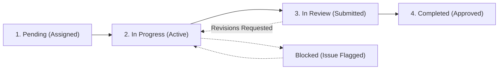

# Nexton Company Portal 🚀
### Role-Based Access Control, Task Lifecycle Operations & Hierarchical Query Escalation

**Nexton Portal** is a production-grade enterprise operations platform built with **Next.js 14 (App Router)**, **MongoDB (Mongoose)**, **Tailwind CSS**, and **JWT Authentication**.

---

## 🌟 Key Architectural Pillars

### 1. 🛡️ Role-Based Access Control (RBAC)
- **Admin**: Executive oversight. Creates all Manager and Employee accounts, assigns employees to reporting managers, creates company-wide tasks, and resolves high-level escalations.
- **Manager**: Team supervision. Directs assigned subordinate employees, delegates tasks, reviews employee deliverables (approves or requests revisions), answers team queries, and escalates critical blockers to Executive Admin.
- **Employee**: Individual contributor workspace. Executes tasks assigned by their manager, updates real-time progress % and lifecycle status (e.g. submits for review), attaches notes, and asks their reporting manager questions via the Query Desk.

### 2. ⚡ Service-Oriented Backend Architecture (`services/`)
To keep API route handlers lean and maintainable, all heavy tasks and business rules are encapsulated in the `services/` directory:
- `services/authService.ts`: Password hashing with bcrypt, session verification, and JWT generation.
- `services/userService.ts`: Account provisioning, organizational hierarchy mapping, manager assignment.
- `services/taskService.ts`: Task creation, lifecycle transitions (`pending` → `in_progress` → `in_review` → `completed` / `blocked`), activity timeline logs, comments thread, and performance metrics.
- `services/queryService.ts`: Hierarchical ticket raising (Employee → Manager, Manager → Admin), threaded discussions, and manager-to-admin escalation engine.
- `services/notificationService.ts`: In-app notification creation, unread badge calculation, and mark-as-read tracking.
- `services/cloudinaryService.ts`: Media uploads and attachment storage with Cloudinary API integration and responsive fallbacks.
- `services/fcmService.ts`: Architecture for Firebase Cloud Messaging (FCM) push notifications.

---

## 🔑 Quick Demo Credentials (Pre-Configured)

All demo accounts share the password: **`Nexton@2025`**

| Role | Name | Email | Reporting Line / Focus |
| :--- | :--- | :--- | :--- |
| **Executive Admin** | Vikram Malhotra | `admin@nexton.com` | Top-level oversight across entire company |
| **Operations Lead (Manager)** | Priya Sharma | `priya.sharma@nexton.com` | Leads Aarav Patel & Neha Gupta |
| **Accounts Head (Manager)** | Rahul Verma | `rahul.verma@nexton.com` | Leads Rohan Mehta |
| **Employee (Operations)** | Aarav Patel | `aarav.patel@nexton.com` | Reports to Priya Sharma |
| **Employee (Design & Brand)** | Neha Gupta | `neha.gupta@nexton.com` | Reports to Priya Sharma |
| **Employee (Business Dev)** | Rohan Mehta | `rohan.mehta@nexton.com` | Reports to Rahul Verma |

> **Tip:** The Login page includes **1-Click Demo Buttons** for instant executive testing without typing!

---

## 🔄 Task Lifecycle Flow



Every lifecycle transition records an **immutable activity log entry** with actor identity, timestamp, and optional transition notes.

---

## ❓ Hierarchical Query & Escalation System

1. **Employee → Manager**: When an employee encounters a blocker or needs clarification, they submit a query directly to their assigned manager.
2. **Manager Review**: The manager can reply to the thread, resolve it, or:
3. **Escalate to Admin**: If the inquiry requires budget approval or higher policy decisions, the manager clicks **"Escalate to Admin"**.
4. **Admin Resolution**: The query immediately appears in the Executive Admin's Query Resolution Central for direct executive intervention.

---

## 🛠️ Environment Variables (`.env.local`)

```env
# MongoDB Connection (Local or Atlas)
MONGODB_URI=mongodb://127.0.0.1:27017/nextone

# JWT Secret Key
JWT_SECRET=nextone_enterprise_jwt_secret_key_super_secure_9921_production

# App URL
NEXT_PUBLIC_APP_URL=http://localhost:3000

# Cloudinary (Free tier media storage)
CLOUDINARY_CLOUD_NAME=demo_nextone
CLOUDINARY_API_KEY=
CLOUDINARY_API_SECRET=

# Firebase Cloud Messaging (FCM) - Reserved for Client setup
FIREBASE_PROJECT_ID=
FIREBASE_CLIENT_EMAIL=
FIREBASE_PRIVATE_KEY=
NEXT_PUBLIC_FIREBASE_VAPID_KEY=
```

---

## 🚀 Getting Started

### 1. Install Dependencies
```bash
npm install
```

### 2. Seed Database (Optional / 1-Click)
You can click **"Reset / Seed DB"** on the `/login` screen, or run:
```bash
npm run seed
```

### 3. Start Development Server
```bash
npm run dev
```
Open [http://localhost:3000](http://localhost:3000) in your browser.

---

## 📦 Deployment to GitHub & Vercel

### Step 1: Push to GitHub
```bash
git init
git add .
git commit -m "Initial commit: NextOne Enterprise Portal"
git branch -M main
git remote add origin https://github.com/<your-username>/nextone-portal.git
git push -u origin main
```

### Step 2: Deploy to Vercel
1. Go to [https://vercel.com/new](https://vercel.com/new) and import your `nextone-portal` repository.
2. In the **Environment Variables** section, add:
   - `MONGODB_URI`: Your MongoDB Atlas connection string (e.g. `mongodb+srv://...`)
   - `JWT_SECRET`: Any random 32+ character string
   - `CLOUDINARY_CLOUD_NAME`, `CLOUDINARY_API_KEY`, `CLOUDINARY_API_SECRET`
3. Click **Deploy**. Vercel will build and deploy the application worldwide!
